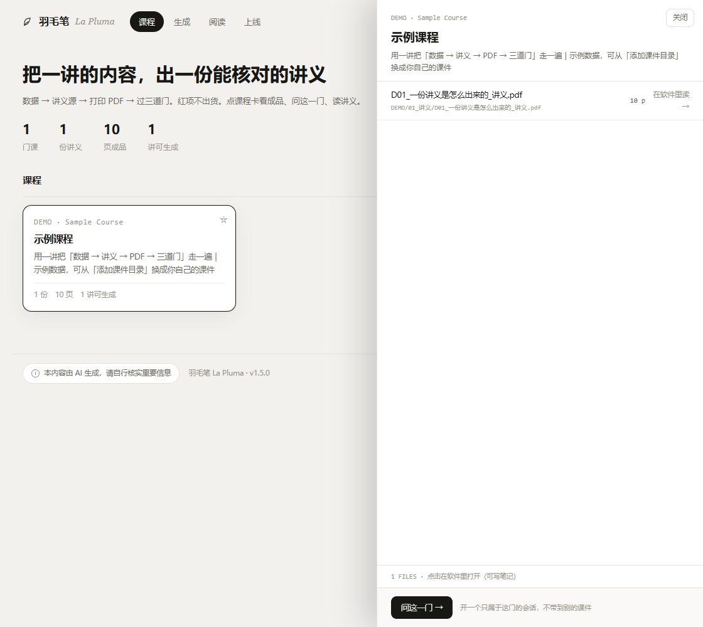
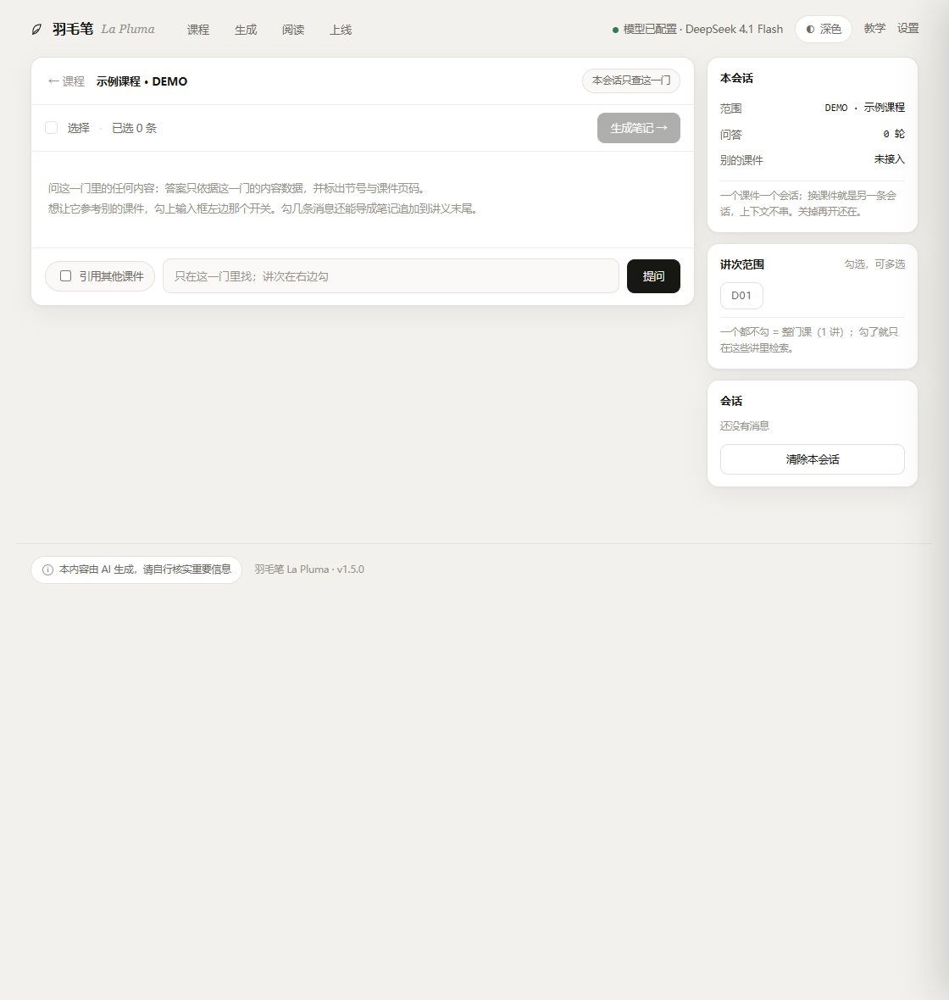

<div align="center">


<br>

[](https://github.com/Charlotte0124/LaPluma/releases/latest)
[](一键启动.ps1)
[](docs/00-总索引.md)


</div>

**把一讲的内容数据，渲染成一份能核对的讲义 PDF。** 同一份数据重跑，页数不该变——这是它和「让 AI 直接写一篇」的根本区别。

| 我想… | 去哪 |
|:--|:--|
| 装上直接用 | [下载](#下载) · [一键启动](#一键启动) |
| 看它长什么样 | [界面](#界面)（真截图） |
| 知道生成怎么跑 | [一条命令](#一条命令) · [三道门](#三道门) |
| 懂它分几层、怎么改 | [分层](#分五层每层可单独换) |
| 看全部文档 | [`docs\00-总索引`](docs/00-总索引.md) |
| 配模型、看余额 | [模型与用量](#模型与用量) |

## 下载

**从源码跑（目前唯一方式）**

```powershell
git clone https://github.com/Charlotte0124/LaPluma.git
cd LaPluma
.\一键启动.ps1
```

- 需要 Python 3.12（脚本会检查并提示），依赖只有一个 `pymupdf`
- 需要本机 Chrome 或 Edge（打印 PDF 用，不用另装）
- **仓库自带示例课程 `DEMO`**：不用准备任何教材就能把「数据 → 讲义 → PDF → 三道门」跑一遍：

```powershell
$env:PLUMA_COURSE='DEMO'
python engine\_make.py D01
```

换你自己的课件：把数据写成 `<课程代码>\_lessons\<讲号>.py`（结构见 `DEMO\_lessons\D01.py`），在 `courses.json` 里登记一行即可。

## 一键启动

`一键启动.ps1` 做四件事：查 Python → 缺 `pymupdf` 就装 → 起本地界面 → 打开浏览器。**只监听 127.0.0.1，不对外。**

```powershell
.\一键启动.ps1
# 或者只要命令行：
python engine\_make.py L01
```

**第一次打开会走配置向导**：选模型版本（4.1 Flash / 4.1 Pro，只有两档）→ 填 API 钥匙（可跳过）→ 选保存目录 → 完成。之后随时在右上「设置」里改。

## 界面

界面是**四个分页（课程 / 生成 / 阅读 / 上线）+ 一条课件会话**，白天黑夜两套主题：

<div align="center">

</div>

<div align="center">


</div>

- **课程**（分页一）：按目录自动识别；卡片右上 ☆ 收进收藏夹，顶部可切「全部 / 收藏」
- **成品**：点课程 → 右侧抽屉列出这一门的 PDF → 点文件名**在软件里读**（不再新开标签）
- **阅读**（分页三）：应用内读 PDF，可翻页、缩放，右侧栏边读边记；深色下**页内文字跟着反相，位图（课件原图）保持原色**
- **笔记**：记在当前页；「添加到这份 PDF」生成副本，把笔记作为附页追加到末尾（不动原件）
- **会话**：抽屉底部「问这一门 →」 → 进这门课自己的会话，答案带节号与课件页码；讲次可多选，跨课件要勾开关
- **导笔记**：勾几条消息 → 生成笔记 → 选一份讲义追加到末尾（默认本地整理，不花 token；想让它整理可勾选）
- **上线**（分页四）：`\一键启动.ps1 -Lan` → 局域网地址 + **8 位访问码**；平板同一 WiFi 输码即用，数据都在本机
- **生成**（分页二）：选课程与讲次 → 弹免责声明 → 开始；任务进队列，**成功后自动消失**，失败留红
- **设置**：模型版本（只有 4.1 两档）、API 钥匙、保存目录、账户余额、累计 token 与估算花费
- **改界面前先看图**：还没实现的稿在 [`docs/预览`](docs/预览/README.md)；改了 `ui\` 要跑 `python tools\check\check-ui-preview.py`，红＝改了界面没带预览图

## 一条命令

```powershell
python engine\_make.py L01
```

```
生成 L01_零基础_讲义_源.html（23738 字符，术语附英 51 处，拆长段 0 处）
OK  CS340/06_笔记/L01_零基础_讲义_源.html
1 份讲义源：OK 1 · WARN 0 · FAIL 0
已写    …\CS340\01_讲义\L01_操作系统是什么_讲义.pdf（1433 KB · 15 页 · 10287 字符）
OK  L01_操作系统是什么_讲义.pdf
```

它不解决什么：**内容对不对，脚本判不了。** 类比是否误导、例题数字是否算过，得人看。每份成品页脚都印着「本内容由 AI 生成，请自行核实重要信息」。

## 分五层，每层可单独换

| 层 | 目录 | 管什么 | 换掉它 |
|:--|:--|:--|:--|
| **A 引擎** | `engine/` | 数据 → 讲义源 HTML（模板、封面、目录、术语表、附录） | 版式变，内容不变 |
| **B 内容** | `CS340/_lessons/` | 每讲一份 `LESSON`：节、讲法、原文引用、符号表 | 内容变，引擎不变 |
| **C 门与打印** | `tools/print/` | 内容门 / 版式门、术语附英、HTML→PDF | 成品出不去 |
| **D 模型** | `api/client.py` | 内容生产的模型调用，key 永不入库 | 已有数据仍能出 PDF |
| **E 界面** | `ui/` | 本地网页：课程、成品、生成、向导、设置 | 只剩命令行 |

A/B/C 三层离线可跑；只有「让 AI 写新内容」才需要 D。

## 三道门

| 门 | 判 | 红了 |
|:--|:--|:--|
| 源 | 课件引用对得上、图注不空 | 停在原地，不给成品 |
| 内容 | `data-reader` · 公式后符号表 · 每节讲法 · 术语首次附英 · 单段 ≤210 字 | 改内容，不改阈值 |
| 版式 | 页首是标题/表格/图注、无空白残页 | 整节搬家或块边界分页 |

**不许为了变绿改检查器**——这是整套东西可信度的全部来源。

## 模型与用量

- 模型：只留两档 —— DeepSeek 4.1 Flash（默认，快省）/ 4.1 Pro（更强）；接口 id 仍是 `deepseek-flash` / `deepseek-v4-pro`，设置里随时可换
- 密钥读取顺序：`PLUMA_API_KEY` 环境变量 → `%USERPROFILE%\.pluma\api.json` → PRTS 侧 secrets → 界面手填
- **余额**是接口读的真数（`/user/balance`）；**花费**按 token 单价估算，界面写明「估」，不是账单

## 最近更新

> 这张表由 `tools\sync-readme.py` 从 [CHANGELOG](CHANGELOG.md) 生成，别手改；`--check` 可验一致性。

<!-- 最近更新:begin（由 tools/sync-readme.py 生成，别手改） -->
| 版本 | 日期 | 这一版做了什么 |
|:--|:--|:--|
| **v1.5.0** | 11-16 | 界面改成**四个分页**：课程 / 生成 / 阅读 / 上线；顶栏一个「◐」切白天黑夜，主题存本机；**05/06 会话页重做**：每条消息可勾选、讲次改成勾选多选（空 = 整门课，可只选几讲）、模型回答按 Markdown 渲染（粗体 / 行内代码 / 代码块，不再把 `**` 直接晒出来）… |
| **v1.4.0** | 11-16 | 界面新增「成品形态」：**单本（默认）/ 合订本**；合订本按 B 口径（一张封面 + 一张总目录，去掉各讲自带的封面与目录），选中时讲次选择自动置灰；新增 `engine/_book.py`：九讲合订本；自检三条——节数与各讲对得上、页数 = 1 + 目录页 + Σ(各讲页数 − 2)、目录 9 条全回填（实测 144 页 = 1 + 1 + 142）… |
| **v1.3.1** | 11-16 | 引擎：`fig` 引用的课件原图改成可配置目录（`~/.pluma/assets.json` → `courses.json` → `PLUMA_ASSETS` → 仓内默认），找到就写绝对 `file://` URI；**找不到就报缺图并停**，不再产出「图是白条、门还报绿」的成品；新增 `tools/assets.py`：`--list` / `--check` / `--set` / `--unset`（本机配置，不入库）… |
| **v1.3.0** | 11-16 | L06 / L08 / L09 重做为练习型：三讲共 54 页 / 25 段代码 / 33 道例题 / 12 张结构图（地址空间对照、create→join 时序、丢更新、条件变量往返；地址轴、调用栈、空闲链表、malloc 间隙；base/limit、段表、页表翻译、两级页表）；L05 排版返工：拆成 15 节、一节一页；块级不可拆（代码/例题/图/表），断点只落在节标题上… |
| **v1.2.1** | 11-16 | L05 重做为练习型：17 页 / 7 段代码 / 11 道例题 / 4 张结构图（三类 IPC、竞争条件时间线、down·up 路径、环形缓冲）；修两个渲染 bug：长段拆分把 </p> 插进了代码块（正则把 <pre> 误当 <p>）；表格里的 ** 粗体没生效… |
<!-- 最近更新:end -->

## 目录

```
engine/            A 引擎（_build_讲义.py / _make.py / _split_long.py / _pagediag.py）
CS340/_lessons/    B 内容数据（L01–L09 九讲）
CS340/06_笔记/     生成的讲义源（不入库）
CS340/01_讲义/     生成的 PDF（不入库）
tools/print/       C 内容门 / 版式门 / 打印 / KaTeX
tools/src/         源门
tools/check/       自检（check-ui-preview.py：界面改动必须先有预览图）
tools/sync-readme.py  主页「最近更新」生成器
api/               D 模型接入
ui/                E 本地界面
docs/              给人看的文档（总索引 → 分类 → 篇）
docs/预览/         界面设计稿（还没实现；实现后由 docs/资产/界面-*.png 接替）
courses.json       课程元数据（标题 / 说明 / 读者口径）
```

## 依赖

Python 3.12、`pymupdf`、本机 Chrome 或 Edge。无前端构建、无 npm、无服务端数据库、无第三方 Web 框架。

## 致谢

- 排版思路与执行纪律沿用本人在 **Rosmarinus（迷迭香）** 项目里磨出来的那套：可机器判的规矩、红项不出货、检查器不许为变绿而改
- 界面与文档的两级索引形式参考 **PRTS** 工作台的「总索引 → 分类 → 篇」结构
- 公式渲染用 [KaTeX](https://katex.org/)（本地字体，不联网）

## 许可与免责

MIT，见 [LICENSE](LICENSE)。

**本内容由 AI 生成，请自行核实重要信息。** 页脚标识不可关闭。
