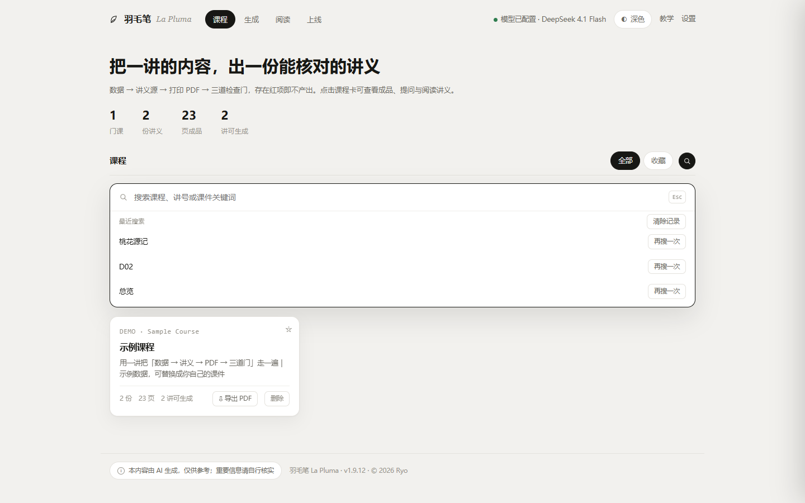

<div align="center">


<br>

[](https://github.com/Charlotte0124/LaPluma/releases/latest)
[](一键启动.ps1)
[](docs/00-总索引.md)


</div>

**把一讲的内容数据，渲染成一份能核对的讲义 PDF。** 同一份数据重跑，页数不该变——这是它和「让 AI 直接写一篇」的根本区别。

| 我想… | 去哪 |
|:--|:--|
| 装上直接用 | [下载](#下载) · [一键启动](#一键启动) |
| 先看它长什么样 | [界面](#界面)（真截图） |
| 看「原始课件 → 成品」差多少 | [示例：桃花源记](docs/示例/README.md)（4 页 → 13 页） |
| 给平板 / 手机用 | [一键启动](#一键启动) 里的「一键上线」（8 位访问码） |
| 换模型 / 看余额 | [设置](#模型与用量)（右上角） |
| 看全部文档 | [`docs\00-总索引`](docs/00-总索引.md) |
| 想改它（加一讲 / 换版式 / 调门） | [分五层](#分五层每层可单独换) · [三道门](#三道门) · [一条命令](#一条命令) |

## 下载

**它解决什么**：你不是想让人工智能写一篇作文，你是想把**已经备好的课**变成一份能打印、页数能核对、每次重跑都一样的讲义 PDF。所以这里的数据是数据、版式是版式、检查是检查——三者分开，任何一处改了都能单测。

**它不解决什么**：内容对不对、类比会不会误导、例题的数字有没有算对，脚本判不了——那一步得你自己看（成品每页页脚都写着「请自行核实重要信息」）。

**从源码跑（目前唯一方式）**

```powershell
git clone https://github.com/Charlotte0124/LaPluma.git
cd LaPluma
.\一键启动.ps1
```

- 需要 Python 3.12（脚本会检查并提示），依赖只有一个 `pymupdf`
- 需要本机 Chrome 或 Edge（打印 PDF 用，不用另装）
- **仓库自带示例课程 `DEMO`**：不用准备任何教材就能把「数据 → 讲义 → PDF → 三道门」跑一遍：

```powershell
$env:PLUMA_COURSE='DEMO'
python engine\_make.py D01
```

换你自己的课件：把数据写成 `<课程代码>\_lessons\<讲号>.py`（结构见 `DEMO\_lessons\D01.py`），在 `courses.json` 里登记一行即可。

> 示例课程现在有两讲：`D01` 讲流水线自身怎么跑，`D02` 是《桃花源记》（13 页），
> 配 [docs\示例](docs/示例/README.md) 里那 4 页**原始课件**一起看，能看出「加工」到底加了什么。

## 功能一览

> 这张表只列**你能上手点到的功能**。三道门、分层、打包这些是软件自己的事，放在后面的「三道门」与「分层」两节。

| 我要做什么 | 在界面上点哪里 | 出来什么 |
|:--|:--|:--|
| **出一讲讲义** | 「生成」页选课程 → 勾要生成的讲次（**可多选**）→ 勾免责声明 → 开始生成 | 每讲一份 PDF，落进你设的保存目录；勾几讲就跑几讲，队列里看得到排队 |
| **全部讲合成一本** | 「生成」页「成品形态」选**合订本** | 一本：1 张封面 + 1 张总目录 + 各讲正文（去掉各讲自带的封面与目录） |
| **在软件里读一份讲义** | 「课程」页点课程卡 → 抽屉里点那份 PDF | 进「阅读」页：翻页、缩放，不新开浏览器标签 |
| **边读边记一笔** | 阅读页右侧输入框，笔记挂在当前 `p.N`；Ctrl+Enter 保存 | 存本机，按「课程 + 文档」分开存；关掉再开还在 |
| **快速找到某门课 / 某份课件** | 「课程」标题右侧的**放大镜**（或 `Ctrl+K`）→ 敲课程名、讲号或课件关键词 | 面板分「课程」「课件」两组；没输字时按浏览器习惯只摆**最近搜过的三条**（只存这台电脑） |
| **把成品导出到本机** | 课程卡右下「⇩ 导出 PDF」→ 弹窗里勾要哪几份（默认全选）→ 导出；搜索结果行「导出」直接导单份 | 只勾一份就下 PDF；勾多份打一个 zip。都落到浏览器的下载文件夹 |
| **把笔记附进 PDF** | 阅读页「添加到这份 PDF」 | 另存一份副本，笔记作为附页追加在末尾，原件不动 |
| **问这门课** | 课程抽屉底部「问这一门 →」 | 一门课一个会话；回答带 §节号与课件页码，右侧可勾讲次缩范围 |
| **把几次问答变成笔记** | 会话里勾几条消息 → 「生成笔记 →」→ 选讲义（**可多选**） | 每份选中的讲义各出一份副本，笔记追加到末尾（本地整理，不花 token） |
| **给平板 / 手机用** | 「上线」页点**一键上线**（不用敲命令、不用重开软件） | 同一 WiFi 打开地址 + 8 位访问码；数据都在本机，关窗口或点「关闭上线」就断 |
| **换模型 / 看余额** | 右上「设置」 | 两档模型随时换、密钥只存本机、余额取接口真数、花费标明是估 |

表里没写的两件事：① **不配密钥也能出 PDF**——已有数据走本地渲染，只有「让 AI 写新内容」才用得到模型；② **每次生成都会自动过三道门**（源 / 内容 / 版式），红了不出货，这条不是按钮，是下面那节。

## 一键启动

`一键启动.ps1` 做四件事：查 Python → 缺 `pymupdf` 就装 → 起本地界面 → 打开浏览器。**默认只监听 127.0.0.1，不对外。**

```powershell
.\一键启动.ps1
# 或者只要命令行：
python engine\_make.py L01
```

**给平板 / 手机用，不用敲命令**：打开界面右上「上线」页 → 点 **一键上线**，当场给出局域网地址与 8 位访问码；点「关闭上线」就断，关窗口也断。命令行等价写法是 `一键启动.ps1 -Lan` 或 `python ui\server.py --lan`，两条路现在走同一段代码。

**第一次打开会走配置向导**：选模型版本（4.1 Flash / 4.1 Pro，只有两档）→ 填 API 钥匙（可跳过）→ 选保存目录 → 完成。之后随时在右上「设置」里改；想重看教学：设置 → 「重看教学」。

## 界面

界面是**四个分页（课程 / 生成 / 阅读 / 上线）+ 一条课件会话**，白天黑夜两套主题。下面三张都是真截图（示例课程 DEMO，1440×900）：

<div align="center">

</div>

<p align="center"><sub><b>问课件</b>：一个课件一个会话；答案只依据这门课的内容数据，每条标出 §节号与课件页码，命中的片段可展开核对。</sub></p>

<div align="center">

</div>

<p align="center"><sub><b>导出笔记</b>：勾几条问答 → 选讲义（可多选，一次跑几份）→ 每份各存一份副本追加附页，不动原件。</sub></p>

<div align="center">

</div>

<p align="center"><sub><b>主机上线</b>：`\一键启动.ps1 -Lan` → 局域网地址 + 8 位访问码；平板同 WiFi 输码即用。（图中地址与访问码为示意值）</sub></p>

<div align="center">

</div>

<p align="center"><sub><b>搜索</b>：放大镜（或 Ctrl+K）展开；课程行可「打开抽屉 / 导出」，课件行可「在软件里读 / 导出」。没输字时只摆最近搜过的三条。</sub></p>

- **课程**（分页一）：按目录自动识别；卡片右上 ☆ 收进收藏夹，顶部可切「全部 / 收藏」；标题右侧**放大镜**（Ctrl+K）可搜课程与课件，卡片右下「⇩ 导出 PDF」把整门打包
- **成品**：点课程 → 右侧抽屉列出这一门的 PDF → 点文件名**在软件里读**（不再新开标签）
- **阅读**（分页三）：应用内读 PDF，可翻页、缩放，右侧栏边读边记；深色下**页内文字跟着反相，位图（课件原图）保持原色**
- **笔记**：记在当前页；「添加到这份 PDF」生成副本，把笔记作为附页追加到末尾（不动原件）
- **会话**：抽屉底部「问这一门 →」 → 进这门课自己的会话，答案带节号与课件页码；讲次可多选，跨课件要勾开关
- **导笔记**：勾几条消息 → 生成笔记 → 选讲义（**可多选**，一次跑几份）追加到末尾（默认本地整理，不花 token；想让它整理可勾选）
- **上线**（分页四）：`\一键启动.ps1 -Lan` → 局域网地址 + **8 位访问码**；平板同一 WiFi 输码即用，数据都在本机
- **生成**（分页二）：选课程与讲次 → 弹免责声明 → 开始；任务进队列，**成功后自动消失**，失败留红
- **设置**：模型版本（只有 4.1 两档）、API 钥匙、保存目录、账户余额、累计 token 与估算花费
- **改界面前先看图**：还没实现的稿在 [`docs/预览`](docs/预览/README.md)；改了 `ui\` 要跑 `python tools\check\check-ui-preview.py`，红＝改了界面没带预览图

## 一条命令

```powershell
python engine\_make.py L01
```

```
生成 L01_零基础_讲义_源.html（23738 字符，术语附英 51 处，拆长段 0 处）
OK  CS340/06_笔记/L01_零基础_讲义_源.html
1 份讲义源：OK 1 · WARN 0 · FAIL 0
已写    …\CS340\01_讲义\L01_操作系统是什么_讲义.pdf（1433 KB · 15 页 · 10287 字符）
OK  L01_操作系统是什么_讲义.pdf
```

它不解决什么：**内容对不对，脚本判不了。** 类比是否误导、例题数字是否算过，得人看。每份成品页脚都印着「本内容由 AI 生成，请自行核实重要信息」。

## 分五层，每层可单独换

| 层 | 目录 | 管什么 | 换掉它 |
|:--|:--|:--|:--|
| **A 引擎** | `engine/` | 数据 → 讲义源 HTML（模板、封面、目录、术语表、附录） | 版式变，内容不变 |
| **B 内容** | `CS340/_lessons/` | 每讲一份 `LESSON`：节、讲法、原文引用、符号表 | 内容变，引擎不变 |
| **C 门与打印** | `tools/print/` | 内容门 / 版式门、术语附英、HTML→PDF | 成品出不去 |
| **D 模型** | `api/client.py` | 内容生产的模型调用，key 永不入库 | 已有数据仍能出 PDF |
| **E 界面** | `ui/` | 本地网页：课程、成品、生成、向导、设置 | 只剩命令行 |

A/B/C 三层离线可跑；只有「让 AI 写新内容」才需要 D。

## 三道门

| 门 | 判 | 红了 |
|:--|:--|:--|
| 源 | 课件引用对得上、图注不空 | 停在原地，不给成品 |
| 内容 | `data-reader` · 公式后符号表 · 每节讲法 · 术语首次附英 · 单段 ≤210 字 | 改内容，不改阈值 |
| 版式 | 页首是标题/表格/图注、无空白残页 | 整节搬家或块边界分页 |

**不许为了变绿改检查器**——这是整套东西可信度的全部来源。

## 模型与用量

- 模型：只留两档 —— DeepSeek 4.1 Flash（默认，快省）/ 4.1 Pro（更强）；接口 id 仍是 `deepseek-flash` / `deepseek-v4-pro`，设置里随时可换
- 密钥读取顺序：`PLUMA_API_KEY` 环境变量 → `%USERPROFILE%\.pluma\api.json` → PRTS 侧 secrets → 界面手填
- **余额**是接口读的真数（`/user/balance`）；**花费**按 token 单价估算，界面写明「估」，不是账单

## 最近更新

> 这张表由 `tools\sync-readme.py` 从 [CHANGELOG](CHANGELOG.md) 生成，别手改；`--check` 可验一致性。

<!-- 最近更新:begin（由 tools/sync-readme.py 生成，别手改） -->
| 版本 | 日期 | 这一版做了什么 |
|:--|:--|:--|
| **v1.8.0** | 11-17 | **课程旁的放大镜（设计稿 15）**：「课程」标题右侧一个圆按钮，展开是搜索栏，`Ctrl+K` 唤出；结果分「课程」「课件」两组。按浏览器逻辑：**没输字时只摆最近搜过的三条**（本机 localStorage，最多存 8 条），Esc 一次清空输入、再一次收起，点结果或回车才算一次「搜索」才进历史；**搜索结果行可直接导出**：课程行是「打开抽屉 / 导出」（整门打包一个 zip），课件行是「在软件里读 / 导出」（单份原 PDF）；课程卡右下角同时有「⇩ 导出 PDF」（设计稿 16），与课程行走同一段后端… |
| **v1.7.0** | 11-17 | **「生成」页布局修好**：根因是 `.pad` 类名撞车——v1.5.0 给上线页的平板预览写了 `.pad{display:flex;align-items:center;text-align:center;min-height:280px}`，而生成页两张卡叫 `class="card pad"`，于是整卡居中、键值不再右贴。平板预览面板改名 `.device`（不是换字体：实测全库字体栈自始至终一致）；**两处字体小偏差**：`<code>` 会被浏览器默认样式抢成 Courier（`.fld code` 已改回继承 Consolas）；`.opt b` 落成 700 字重（已定 600）… |
| **v1.6.0** | 11-17 | **打包地基**：新增 `paths.py`，把「只读资源」与「可写数据」分成两根；`/api/generate` 与引擎内部全部改成进程内调用，不再用 `sys.executable` 起第二个 exe；新增判据 `tools\check\check-paths.py`：假打包现场判 7 项，自带造坏自测（造坏 3 红、复原 7 绿）… |
| **v1.5.0** | 11-16 | 界面改成**四个分页**：课程 / 生成 / 阅读 / 上线；顶栏一个「◐」切白天黑夜，主题存本机；**05/06 会话页重做**：每条消息可勾选、讲次改成勾选多选（空 = 整门课，可只选几讲）、模型回答按 Markdown 渲染（粗体 / 行内代码 / 代码块，不再把 `**` 直接晒出来）… |
| **v1.4.0** | 11-16 | 界面新增「成品形态」：**单本（默认）/ 合订本**；合订本按 B 口径（一张封面 + 一张总目录，去掉各讲自带的封面与目录），选中时讲次选择自动置灰；新增 `engine/_book.py`：九讲合订本；自检三条——节数与各讲对得上、页数 = 1 + 目录页 + Σ(各讲页数 − 2)、目录 9 条全回填（实测 144 页 = 1 + 1 + 142）… |
<!-- 最近更新:end -->

## 目录

```
paths.py           路径双根（只读资源 / 可写数据，冻结后各指一处）
engine/            A 引擎（_build_讲义.py / _make.py / _split_long.py / _pagediag.py）
CS340/_lessons/    B 内容数据（L01–L09 九讲，不入公开仓）
DEMO/_lessons/     示例课程数据（D01 流水线自述、D02 桃花源记）
CS340/06_笔记/     生成的讲义源（不入库）
CS340/01_讲义/     生成的 PDF（不入库）
tools/print/       C 内容门 / 版式门 / 打印 / KaTeX / pdf.js
tools/src/         源门
tools/check/       自检（check-ui-preview.py 界面先出图；check-paths.py 路径双根）
tools/sync-readme.py  主页「最近更新」生成器
api/               D 模型接入
ui/                E 本地界面
docs/              给人看的文档（总索引 → 分类 → 篇）
docs/示例/         桃花源记：原始课件（范本）与加工后讲义
courses.json       课程元数据（标题 / 说明 / 读者口径）
```

## 依赖

Python 3.12、`pymupdf`、本机 Chrome 或 Edge。无前端构建、无 npm、无服务端数据库、无第三方 Web 框架。

## 致谢

- 排版思路与执行纪律沿用本人在 **Rosmarinus（迷迭香）** 项目里磨出来的那套：可机器判的规矩、红项不出货、检查器不许为变绿而改
- 界面与文档的两级索引形式参考 **PRTS** 工作台的「总索引 → 分类 → 篇」结构
- 公式渲染用 [KaTeX](https://katex.org/)（本地字体，不联网）

## 许可与免责

MIT，见 [LICENSE](LICENSE)。

**本内容由 AI 生成，请自行核实重要信息。** 页脚标识不可关闭。
