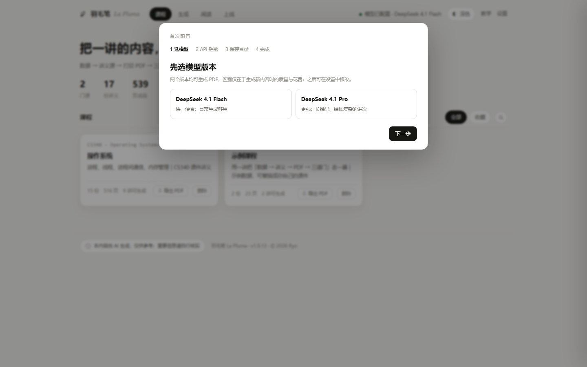

<div align="center">


<br>

[](https://github.com/Charlotte0124/LaPluma/releases/latest)
[](一键启动.ps1)
[](docs/00-总索引.md)


</div>

**把一讲的内容数据，渲染成一份能核对的讲义 PDF。** 同一份数据重跑，页数不该变——这是它和「让 AI 直接写一篇」的根本区别。

| 我想… | 去哪 |
|:--|:--|
| 装上直接用 | [下载](#下载) · [一键启动](#一键启动) |
| 看它长什么样 | [界面](#界面)（真截图） |
| 知道生成怎么跑 | [一条命令](#一条命令) · [三道门](#三道门) |
| 懂它分几层、怎么改 | [分层](#分五层每层可单独换) |
| 看全部文档 | [`docs\00-总索引`](docs/00-总索引.md) |
| 配模型、看余额 | [模型与用量](#模型与用量) |

## 下载

**① 下载安装包（推荐）**：[`LaPluma-1.1.0.zip`](https://github.com/Charlotte0124/LaPluma/releases/latest) → 解压到任意目录 → 双击 `一键启动.ps1`。

- 需要 Python 3.12（脚本会检查并提示），依赖只有一个 `pymupdf`
- 需要本机 Chrome 或 Edge（打印 PDF 用，不用另装）
- 仓库是私有的，下载前先登录 GitHub

**② 从源码跑**

```powershell
git clone https://github.com/Charlotte0124/LaPluma.git
cd LaPluma
.\一键启动.ps1
```

## 一键启动

`一键启动.ps1` 做四件事：查 Python → 缺 `pymupdf` 就装 → 起本地界面 → 打开浏览器。**只监听 127.0.0.1，不对外。**

```powershell
.\一键启动.ps1
# 或者只要命令行：
python engine\_make.py L01
```

**第一次打开会走配置向导**：选模型版本（Flash / V4 Pro）→ 填 API 钥匙（可跳过）→ 选保存目录 → 完成。之后随时在右上「设置」里改。

## 界面

<div align="center">

</div>

<div align="center">


</div>

- **课程**：按目录自动识别；卡片右上 ☆ 收进收藏夹，顶部可切「全部 / 收藏」
- **成品**：点课程 → 右侧列出这一门的 PDF → 点文件名直接打开
- **生成**：选课程与讲次 → 弹免责声明 → 开始；任务进队列，**成功后自动消失**，失败留红
- **设置**：模型版本、API 钥匙、保存目录、账户余额、累计 token 与估算花费

## 一条命令

```powershell
python engine\_make.py L01
```

```
生成 L01_零基础_讲义_源.html（23738 字符，术语附英 51 处，拆长段 0 处）
OK  CS340/06_笔记/L01_零基础_讲义_源.html
1 份讲义源：OK 1 · WARN 0 · FAIL 0
已写    …\CS340\01_讲义\L01_操作系统是什么_讲义.pdf（1433 KB · 15 页 · 10287 字符）
OK  L01_操作系统是什么_讲义.pdf
```

它不解决什么：**内容对不对，脚本判不了。** 类比是否误导、例题数字是否算过，得人看。每份成品页脚都印着「本内容由 AI 生成，请自行核实重要信息」。

## 分五层，每层可单独换

| 层 | 目录 | 管什么 | 换掉它 |
|:--|:--|:--|:--|
| **A 引擎** | `engine/` | 数据 → 讲义源 HTML（模板、封面、目录、术语表、附录） | 版式变，内容不变 |
| **B 内容** | `CS340/_lessons/` | 每讲一份 `LESSON`：节、讲法、原文引用、符号表 | 内容变，引擎不变 |
| **C 门与打印** | `tools/print/` | 内容门 / 版式门、术语附英、HTML→PDF | 成品出不去 |
| **D 模型** | `api/client.py` | 内容生产的模型调用，key 永不入库 | 已有数据仍能出 PDF |
| **E 界面** | `ui/` | 本地网页：课程、成品、生成、向导、设置 | 只剩命令行 |

A/B/C 三层离线可跑；只有「让 AI 写新内容」才需要 D。

## 三道门

| 门 | 判 | 红了 |
|:--|:--|:--|
| 源 | 课件引用对得上、图注不空 | 停在原地，不给成品 |
| 内容 | `data-reader` · 公式后符号表 · 每节讲法 · 术语首次附英 · 单段 ≤210 字 | 改内容，不改阈值 |
| 版式 | 页首是标题/表格/图注、无空白残页 | 整节搬家或块边界分页 |

**不许为了变绿改检查器**——这是整套东西可信度的全部来源。

## 模型与用量

- 模型：`deepseek-flash`（默认，快省）、`deepseek-v4-pro`（更强）
- 密钥读取顺序：`PLUMA_API_KEY` 环境变量 → `%USERPROFILE%\.pluma\api.json` → PRTS 侧 secrets → 界面手填
- **余额**是接口读的真数（`/user/balance`）；**花费**按 token 单价估算，界面写明「估」，不是账单

## 最近更新

> 这张表由 `tools\sync-readme.py` 从 [CHANGELOG](CHANGELOG.md) 生成，别手改；`--check` 可验一致性。

<!-- 最近更新:begin（由 tools/sync-readme.py 生成，别手改） -->
| 版本 | 日期 | 这一版做了什么 |
|:--|:--|:--|
| **v1.2.1** | 11-16 | L05 重做为练习型：17 页 / 7 段代码 / 11 道例题 / 4 张结构图（三类 IPC、竞争条件时间线、down·up 路径、环形缓冲）；修两个渲染 bug：长段拆分把 </p> 插进了代码块（正则把 <pre> 误当 <p>）；表格里的 ** 粗体没生效… |
| **v1.2.0** | 11-16 | 讲义改口径：以代码、例题运算为主，理论只作铺垫；需要时配结构示意图；引擎新增三种块：代码（code）、例题（eg）、结构图（svg）；术语附英不再误入图与代码… |
| **v1.1.0** | 11-16 | 新增首次配置向导（选模型 → 填 API 钥匙 → 选保存目录 → 完成），未配置时自动弹出；新增设置面板：模型版本、密钥、保存目录、账户余额、累计 token 与估算花费… |
| **v1.0.0** | 11-16 | 补齐 L01「操作系统是什么」，九讲齐（9 份 / 166 页），三门全绿；版本定到 v1.0.0；主页横幅、界面截图重出 |
| **v0.3.0** | 11-16 | 新增 E 层本地界面（`ui/`）：课程卡片 → 成品列表 → 点击直接打开；生成前免责声明；新增用户文档（总索引 → 分类 → 篇）与主页横幅 |
<!-- 最近更新:end -->

## 目录

```
engine/            A 引擎（_build_讲义.py / _make.py / _split_long.py / _pagediag.py）
CS340/_lessons/    B 内容数据（L01–L09 九讲）
CS340/06_笔记/     生成的讲义源（不入库）
CS340/01_讲义/     生成的 PDF（不入库）
tools/print/       C 内容门 / 版式门 / 打印 / KaTeX
tools/src/         源门
tools/sync-readme.py  主页「最近更新」生成器
api/               D 模型接入
ui/                E 本地界面
docs/              给人看的文档（总索引 → 分类 → 篇）
courses.json       课程元数据（标题 / 说明 / 读者口径）
```

## 依赖

Python 3.12、`pymupdf`、本机 Chrome 或 Edge。无前端构建、无 npm、无服务端数据库、无第三方 Web 框架。

## 致谢

- 课程素材与讲义骨架来自 **CS340 操作系统**课程（Xuan Xie，MUST），课件由 Prof. Subrota Kumar Mondal 提供
- 排版思路与执行纪律沿用本人在 **Rosmarinus（迷迭香）** 项目里磨出来的那套：可机器判的规矩、红项不出货、检查器不许为变绿而改
- 界面与文档的两级索引形式参考 **PRTS** 工作台的「总索引 → 分类 → 篇」结构
- 公式渲染用 [KaTeX](https://katex.org/)（本地字体，不联网）

## 许可与免责

MIT，见 [LICENSE](LICENSE)。

**本内容由 AI 生成，请自行核实重要信息。** 页脚标识不可关闭。
