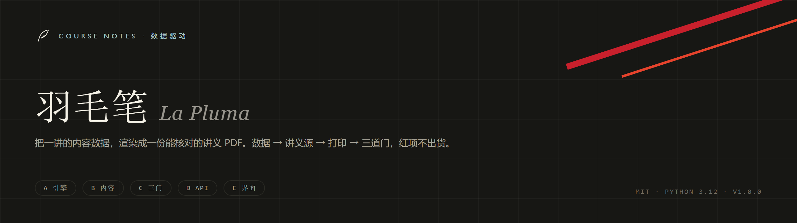
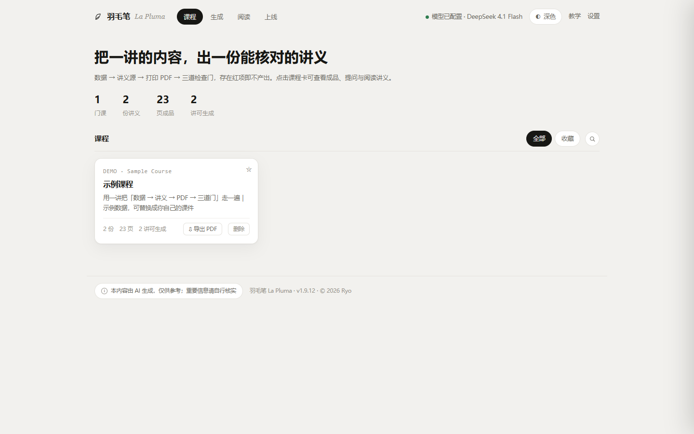

<div align="center">



把一讲的内容数据，渲染成一份能核对的讲义 PDF。

[](LICENSE)


[快速开始](docs/使用/01-快速开始.md) · [怎么出一讲](docs/使用/02-生成一讲讲义.md) · [三道门](docs/使用/03-三道门.md) · [API 与密钥](docs/使用/04-API与密钥.md)

</div>

---

## 它能干什么

写一次内容数据，出一条命令，拿到一份排版确定、目录页码自动回填、术语带英文的 PDF。**同一份数据重跑，页数不该变**——这是它和「让 AI 直接写一篇」的根本区别。

```powershell
python engine\_make.py L02
```

```
生成 L02_零基础_讲义_源.html（30645 字符，术语附英 56 处，拆长段 0 处）
OK  CS340/06_笔记/L02_零基础_讲义_源.html
1 份讲义源：OK 1 · WARN 0 · FAIL 0
已写    …\CS340\01_讲义\L02_进程的基本管理_讲义.pdf（1622 KB · 18 页 · 13854 字符）
OK  L02_进程的基本管理_讲义.pdf
```

它不解决什么：**内容对不对，脚本判不了。** 类比是否误导、例题数字是否算过，得人看。每份成品页脚都印着「本内容由 AI 生成，请自行核实重要信息」。

## 分五层，每层可单独换

| 层 | 目录 | 管什么 | 换掉它 |
|:--|:--|:--|:--|
| **A 引擎** | `engine/` | 数据 → 讲义源 HTML（模板、封面、目录、术语表、附录） | 版式变，内容不变 |
| **B 内容** | `CS340/_lessons/` | 每讲一份 `LESSON`：节、讲法、原文引用、符号表 | 内容变，引擎不变 |
| **C 门与打印** | `tools/print/` | 内容门 / 版式门、术语附英、HTML→PDF | 成品出不去 |
| **D 模型** | `api/client.py` | 内容生产用的模型调用，key 永不入库 | 已有数据仍能出 PDF |
| **E 界面** | `ui/` | 本地网页：选课、看成品、生成、免责声明 | 只剩命令行 |

A/B/C 三层离线可跑；只有「让 AI 写新内容」才需要 D。

## 界面

<div align="center"></div>

<div align="center"></div>

```powershell
python ui\server.py      # http://127.0.0.1:8765/
```

点课程 → 右侧列出成品 → 点文件名直接打开 PDF。生成前弹免责声明，勾选才能继续。

## 三道门

| 门 | 判 | 红了 |
|:--|:--|:--|
| 源 | 课件引用对得上、图注不空 | 停在原地，不给成品 |
| 内容 | `data-reader` · 公式后符号表 · 每节讲法 · 术语首次附英 · 单段 ≤210 字 | 改内容，不改阈值 |
| 版式 | 页首是标题/表格/图注、无空白残页 | 整节搬家或块边界分页 |

**不许为了变绿改检查器**——这是整套东西可信度的全部来源。

## 目录

```
engine/            A 引擎（_build_讲义.py / _make.py / _split_long.py / _pagediag.py）
CS340/_lessons/    B 内容数据（L01–L09，9 讲）
CS340/06_笔记/     生成的讲义源（不入库）
CS340/01_讲义/     生成的 PDF（不入库）
tools/print/       C 内容门 / 版式门 / 打印 / KaTeX
tools/src/         源门
api/               D 模型接入
ui/                E 本地界面
docs/              给人看的文档（总索引 → 分类 → 篇）
```

## 依赖

Python 3.12、`pymupdf`、本机 Chrome 或 Edge。无前端构建、无 npm、无服务端数据库。

## 许可与免责

MIT，见 [LICENSE](LICENSE)。

**本内容由 AI 生成，请自行核实重要信息。** 页脚标识不可关闭。
