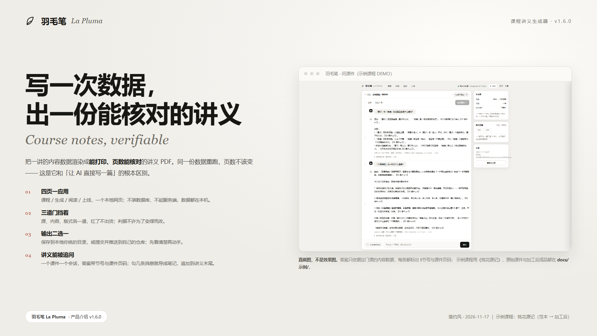
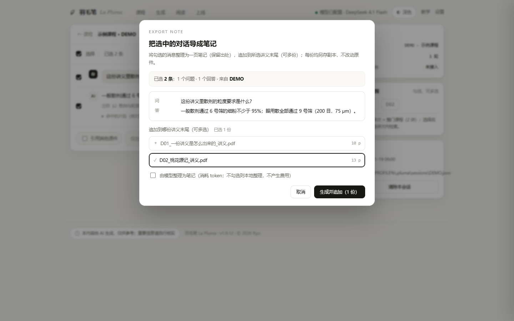

<div align="center">

# 羽毛笔 La Pluma

**把备课数据渲染成可核对、可复现的讲义 PDF**（Windows 单文件 exe，无需 Python）



<br><br>

### ⭐ 如果本项目对你有帮助，欢迎 Star
**这是我继续开发的最大支持。**

</div>

<div align="center">

<a href="https://github.com/Charlotte0124/LaPluma/releases/latest"></a>
&nbsp;
<a href="一键启动.ps1"></a>
&nbsp;
<a href="docs/00-总索引.md"></a>

<sub>↑ 以上三项均可直接点击：下载 / 一键启动 / 文档</sub>

</div>

<div align="center">


</div>

## 目的

把**备课**与**排版**这两件事彻底分开。

一次备课的成果应当可以长期复用：换一个学期、换一台电脑、换一家打印店，产出的讲义仍是同一份。而多数「AI 直接生成文档」的链路做不到这一点——同样的输入运行两次，页数、编号、术语都可能不同，于是成品既难以核对，也无法交给别人复核。

本项目要验证的命题是：只要数据足够规整、检查足够严格，讲义这类高度结构化的文档就可以像程序一样被构建、被验收、被回归测试。

## 它是什么

羽毛笔（La Pluma）是一个**本地优先的讲义渲染器**。

输入是你已经备好的课程数据——每一讲的结构、讲法、原文引用与符号表，写成一份可读的 Python 数据文件；输出是一份可打印、可核对的讲义 PDF。渲染过程是确定性的：**同一份数据重跑，页数不该变**，章节目录、术语表首现位置、图注与原文页码也都不该变。这是它与「让模型直接写一篇」的根本区别。

两者是不同类型的工具：语言模型擅长发散与起草；讲义需要的是可复现、可审阅、可追责——学生拿到的每一页都能对回原始课件的页码，出了问题能定位到具体一节，而不是归因于「模型今天的输出不一样」。

为此，项目把三件事拆开：

| 拆开的 | 在哪 | 为什么 |
|:--|:--|:--|
| 数据 | B 层：每讲一份 `LESSON` | 内容改动不该引起版式变动 |
| 版式 | A 层：`engine/` | 版式改动不该引起内容变动 |
| 检查 | C 层：`tools/print/`、`tools/src/` | 检查与生产解耦，红了就不出货 |

**三种使用方式**：

1. **已有内容数据 → 出 PDF**：只要这一讲的 `LESSON` 数据在，不需要任何 API 密钥，全程离线。
2. **改内容 → 重跑一条命令**：改那一讲的 `LESSON` 数据，`python engine\_make.py <讲号>`。
3. **需要密钥的只有几件**：问课件、让模型整理笔记、让模型撰写新内容。不配也不影响上面两种。

| 我想… | 去哪 |
|:--|:--|
| 装上直接用 | [下载](#下载) · [一键启动](#一键启动) |
| 先看它长什么样 | [界面](#界面)（真截图） |
| 看「原始课件 → 成品」差多少 | [示例：桃花源记](docs/示例/README.md)（4 页 → 13 页） |
| 导入自己的课件 | 点课程卡 → 抽屉顶部「＋ 导入课件」，或将文件直接拖入窗口（PDF / 图片 / Word / PowerPoint / 文本 / Markdown，见[支持哪些格式](docs/使用/09-支持的文件格式.md)） |
| **弄到一串 API 密钥**（手把手，带常见报错对照） | [怎么拿到 API 密钥](docs/使用/08-怎么拿到API密钥.md) |
| 给平板 / 手机用 | [一键启动](#一键启动) 里的「一键上线」（8 位访问码） |
| 知道生成怎么跑 | [一条命令](#一条命令) · [三道门](#三道门) |
| 懂它分几层、怎么改 | [分五层](#分五层每层可单独换) |
| 看全部文档 | [`docs\00-总索引`](docs/00-总索引.md) |
| 配模型、看余额 | [模型与用量](#模型与用量) |

## 下载

**它解决的问题**：不是让模型写一篇作文，而是把**已经备好的课**变成一份可打印、页数可核对、每次重跑都一致的讲义 PDF。数据、版式、检查三者分离，任何一处改动都可以单独验证。

**它不解决的问题**：内容是否正确、类比是否恰当、例题数字是否算对，脚本无法判定——这一步必须由人复核。每份成品的页脚固定印着软件名、可点的项目地址，以及「本内容由 AI 生成，仅供参考；重要信息请自行核实」。

**直接运行（Windows，最简单）**

从 [Releases](https://github.com/Charlotte0124/LaPluma/releases/latest) 下载 `LaPluma.exe`（约 108 MB），双击运行：
打开独立窗口（标题栏显示版本号），关闭窗口即退出；首次启动需解包，约需数秒。
**不需要 Python，也不需要装任何依赖**——运行环境已经打在里面。

- 导入的课程、生成的 PDF 与日志均位于 **exe 旁**；配置在 `%USERPROFILE%\.pluma`
- 自带示例课程 `DEMO`（2 讲），内容数据齐备，**不配密钥也能出 PDF**；要换成自己的课，在 exe 旁边建 `<课程代码>\_lessons\` 并在 `courses.json` 里登记
- 需要本机 Chrome 或 Edge（打印 PDF 用），无需另装

**从源码运行**

```powershell
git clone https://github.com/Charlotte0124/LaPluma.git
cd LaPluma
.\一键启动.bat
```

- 双击 `一键启动.bat`；**不要直接双击 `.ps1`**（默认设置下它会被记事本打开，不运行）
- 需要 Python 3.12（脚本会检查版本并提示），依赖只有 `pymupdf`——缺了脚本会自动装
- 自动安装失败时参见 [用 CMD 装依赖](docs/使用/07-装依赖-用CMD.md)（三步，粘贴两行命令）
- 需要本机 Chrome 或 Edge（用于打印 PDF，无需另行安装）
- **仓库自带示例课程 `DEMO`**：无需准备任何教材，即可完整走一遍「数据 → 讲义 → PDF → 三道门」：

```powershell
$env:PLUMA_COURSE='DEMO'
python engine\_make.py D01
```

接入自己的课件：把数据写成 `<课程代码>\_lessons\<讲号>.py`（结构见 `DEMO\_lessons\D01.py`），并在 `courses.json` 中登记一行。

> 示例课程包含两讲：`D01` 说明流水线自身的运行方式，`D02` 是《桃花源记》（13 页）。
> 配合 [docs\示例](docs/示例/README.md) 中那 4 页**原始课件**对照阅读，可以看出「加工」究竟增加了什么。

## 一键启动

`一键启动.bat`（它调 `一键启动.ps1`）做三件事：查 Python 3.12 → 缺 `pymupdf` 就自动装 → 启动界面（默认开原生窗口；加 `-NoWindow` 才回浏览器页）。**默认仅监听 127.0.0.1，不对外网开放。**

```powershell
.\一键启动.ps1
# 或仅需命令行：
python engine\_make.py L01
```

**平板 / 手机使用**：打开界面右上「上线」页 → 点击 **一键上线**，当场给出局域网地址与 8 位访问码；点击「关闭上线」或在运行主机上关闭窗口即断开。命令行等价写法为 `一键启动.ps1 -Lan` 或 `python ui\server.py --lan`，两者执行同一段代码。

**首次启动会进入配置向导**：选择模型版本（4.1 Flash / 4.1 Pro，两档）→ 填写 API 密钥（可跳过）→ 选择保存目录 → 完成。之后可随时在右上「设置」中修改；如需重看引导，进入设置点击「重看教学」。

## 界面

界面分为**四个分页（课程 / 生成 / 阅读 / 上线）**，外加课件会话与搜索面板，支持日间 / 夜间两套主题。以下截图均来自示例课程 DEMO，1440×900。

<div align="center">

</div>

<p align="center"><sub><b>课件会话</b>：一门课一个会话；回答仅依据该课程的内容数据，每条附 §节号与课件页码，命中片段可展开核对。</sub></p>

<div align="center">

</div>

<p align="center"><sub><b>搜索</b>：放大镜（或 Ctrl+K）展开；课程行可「打开抽屉 / 导出」，课件行可「在软件里读 / 导出」。未输入时仅列出最近搜索的三条。</sub></p>

<div align="center">

</div>

<p align="center"><sub><b>导出</b>：选择「分册 / 合订本」，勾选需要的讲义（默认全选）；单份直接下载，多份打包，合订本拼成一册。</sub></p>

<div align="center">

</div>

<p align="center"><sub><b>导出笔记</b>：勾选问答 → 选择讲义（可多选）→ 每份各生成副本并追加附页，原件不动。</sub></p>

<div align="center">

</div>

<p align="center"><sub><b>主机上线</b>：一键上线后给出局域网地址与 8 位访问码，同一局域网内输入访问码即可使用。（图中地址与访问码为文档示例值）</sub></p>

- **课程**（分页一）：按目录自动识别；卡片右上 ☆ 加入收藏，顶部可切换「全部 / 收藏」；标题右侧**放大镜**（Ctrl+K）可检索课程与课件；卡片右下「⇩ 导出 PDF」导出该门成品
- **删除**：讲次区「全选」左侧「删除」进入删除模式（每个讲号右上角出现红 ×）；抽屉内每份原件 / 成品行右侧「删除」；课程卡底部「删除」整门移除（需照抄课程代号确认）。全部删除均为**移入 `<软件目录>\_trash\<时间戳>\`**，可手动取回，不做物理删除
- **成品**：点击课程 → 右侧抽屉列出该门讲义 → 点击文件名在软件内阅读（不打开新标签页）
- **导入原件**：抽屉顶部「＋ 导入课件」选文件，或把 PDF / 图片直接拖进窗口；原件存到该课 `00_原件\`，与成品分两段列出，同样可点开在内读
- **阅读**（分页三）：应用内阅读 PDF，支持翻页、缩放、**全屏**（按钮或 F 键，Esc 退出），右侧栏可边读边记；深色主题下正文反相，位图（课件原图）保持原色
- **笔记**：记录在当前页；「添加到这份 PDF」生成副本，将笔记作为附页追加至末尾（不改动原件）
- **会话**：抽屉底部「提问本课程 →」进入该课程专属会话，答案附节号与课件页码；讲次可多选，跨课件引用需显式开启
- **导出笔记**：勾选消息 → 生成笔记 → 选择讲义（可多选）追加至末尾（默认本地整理，不消耗 token）
- **生成**（分页二）：选择课程与讲次（可多选）→ 确认免责声明 → 开始；任务进入队列（可逐项取消），成功后自动移除，失败标红
- **上线**（分页四）：一键上线 → 局域网地址 + 8 位访问码；数据全部留在本机
- **设置**：模型版本（4.1 两档）、API 密钥、保存目录、账户余额、累计 token 与估算花费
- **许可**：代码 MIT · 示例内容与截图 CC BY-NC 4.0（不可商用）· 文档正文 CC BY 4.0 · 名称与图标保留权利，边界见 [`NOTICE.md`](NOTICE.md)
- **界面改动流程**：尚未实现的稿件在 [`docs/预览`](docs/预览/README.md)；修改 `ui\` 后需运行 `python tools\check\check-ui-preview.py`

## 功能

| 要做什么 | 点哪里 | 出来什么 |
|:--|:--|:--|
| 出一讲或多讲的讲义 PDF | 「生成」页勾讲次 → 开始生成 | 单本 PDF；三道门有红项则不产出 |
| 把自己的课件放进软件 | 「生成」页「＋ 导入课件」，或将 PDF 拖入窗口 | 存到 `00_原件\`，并自动建一讲占位数据 |
| 看这一门有哪些成品 | 课程页点卡片 | 右侧抽屉分「原件 / 成品」两段，点开即读 |
| 一边读一边记、把笔记并进 PDF | 阅读页右侧栏 | 笔记存本机；导出为附页副本，不改动原件 |
| 问这一门的内容 | 抽屉底部「提问本课程」 | 回答带 §节号与课件页码，命中片段可展开核对 |
| 导到平板 / 手机看 | 「上线」页「一键上线」 | 局域网地址 + 8 位访问码；数据不离本机 |
| 删掉不要的讲次 / 课件 / 整门课 | 讲次区「删除」· 卡片「删除」· 抽屉行「删除」 | 移入 `_trash` 可取回；队列项也能逐项取消 |

## 一条命令

```powershell
$env:PLUMA_COURSE='DEMO'
python engine\_make.py D01
```

实测输出（v1.9.0）：

```
生成 D01_零基础_讲义_源.html（16479 字符，术语附英 7 处，拆长段 0 处）
OK  DEMO/06_笔记/D01_零基础_讲义_源.html
1 份讲义源：OK 1 · WARN 0 · FAIL 0
已写    …\DEMO\01_讲义\D01_一份讲义是怎么出来的_讲义.pdf（1274 KB · 10 页 · 4722 字符）
WARN  D01_一份讲义是怎么出来的_讲义.pdf
      ! 页码引用偏少 1 处/10 页
```

它不解决的问题：**内容是否正确，脚本无法判定。** 类比是否恰当、例题数字是否经过验算，需要人工复核。每份成品页脚均印着软件名、可点项目地址与「本内容由 AI 生成，仅供参考；重要信息请自行核实」。

## 分五层，每层可单独替换

| 层 | 目录 | 职责 | 替换后的影响 |
|:--|:--|:--|:--|
| **A 引擎** | `engine/` | 数据 → 讲义源 HTML（模板、封面、目录、术语表、附录） | 版式变化，内容不变 |
| **B 内容** | `CS340/_lessons/` | 每讲一份 `LESSON`：节、讲法、原文引用、符号表 | 内容变化，引擎不变 |
| **C 门与打印** | `tools/print/` | 内容门 / 版式门、术语附英、HTML→PDF | 成品无法产出 |
| **D 模型** | `api/client.py` | 内容生产所用的模型调用，密钥永不入库 | 已有数据仍可生成 PDF |
| **E 界面** | `ui/` | 本地窗口：课程、成品、生成、向导、设置 | 仅剩命令行 |

A/B/C 三层可离线运行；仅「让模型撰写新内容」时才需要 D 层。

## 三道门

| 门 | 判定内容 | 不通过时 |
|:--|:--|:--|
| 源 | 课件引用对得上、图注非空 | 停止，不产出成品 |
| 内容 | `data-reader` · 公式后符号表 · 每节讲法 · 术语首次附英 · 单段 ≤210 字 | 修改内容，不放宽阈值 |
| 版式 | 页首为标题/表格/图注、无空白残页 | 整节迁移或调整块边界分页 |

**检查器不得为了通过而放宽。** 这是整套工具可信度的全部来源。

## 模型与用量

- 模型：仅保留两档 —— DeepSeek 4.1 Flash（默认，快且省）/ 4.1 Pro（质量更高）；接口 id 为 `deepseek-flash` / `deepseek-v4-pro`，设置中可随时切换
- 密钥读取顺序：`PLUMA_API_KEY` 环境变量 → `%USERPROFILE%\.pluma\api.json` → PRTS 侧 secrets → 界面填写
- **什么时候必须有密钥**：问课件（`/api/ask`）、让模型整理笔记（导出笔记里的勾选项）、让模型撰写新内容。**只出 PDF 不需要**；但生成前提是那一讲的内容数据（`_lessons\<讲号>.py`）已经存在
- **余额**取自接口真实数值（`/user/balance`）；**花费**按 token 单价估算，界面明确标注「估」，不作为账单

## 最近更新

> 本表由 `tools\sync-readme.py` 从 [CHANGELOG](CHANGELOG.md) 生成，请勿手改；`--check` 可校验一致性。

<!-- 最近更新:begin（由 tools/sync-readme.py 生成，别手改） -->
| 版本 | 日期 | 这一版做了什么 |
|:--|:--|:--|
| **v1.9.9** | 11-17 | 更新源从 2 个变 4 个并并行读取，发版后能立刻拿到新版，不会因为某个 CDN 缓存被降级 |
| **v1.9.8** | 11-17 | 修「CDN 缓存旧清单把用户降回旧版」的问题；更新源多个时一律取版本号最高的 |
| **v1.9.7** | 11-17 | 修「先下本体再下资源包」时把资源包当成程序换上的严重 bug；更新的每一步都能复验 |
| **v1.9.6** | 11-17 | 资源包与程序本体分开更新；图注自动编号并能查；文档与图标改成程序目录优先 |
| **v1.9.5** | 11-17 | 成品 PDF 页脚印上软件名、项目地址与 AI 免责；更新可以在应用里一键装完，全程不跳出软件 |
| — | — | 更早的 21 个版本 → [CHANGELOG](CHANGELOG.md) |
<!-- 最近更新:end -->

## 目录

```
paths.py           路径双根（只读资源 / 可写数据，冻结后各指一处）
engine/            A 引擎（_build_讲义.py / _make.py / _split_long.py / _pagediag.py）
CS340/_lessons/    B 内容数据（L01–L09 九讲，不入公开仓）
DEMO/_lessons/     示例课程数据（D01 流水线自述、D02 桃花源记）
CS340/06_笔记/     生成的讲义源（不入库）
CS340/01_讲义/     生成的 PDF（不入库）
tools/print/       C 内容门 / 版式门 / 打印 / KaTeX / pdf.js
tools/src/         源门
tools/check/       自检（check-ui-preview.py 界面先出图；check-paths.py 路径双根）
tools/sync-readme.py  主页「最近更新」生成器
api/               D 模型接入
ui/                E 本地界面
docs/              项目文档（总索引 → 分类 → 篇）
docs/示例/         桃花源记：原始课件（范本）与加工后讲义
courses.json       课程元数据（标题 / 说明 / 读者口径）
```

## 依赖

**用 exe**：什么都不用装，双击即可（Chrome / Edge 用系统自带的）。

**从源码跑**：Python 3.12、`pymupdf`、本机 Chrome 或 Edge。无前端构建、无 npm、无服务端数据库、无第三方 Web 框架。

## 致谢

- 排版思路与工程纪律沿用在 **Rosmarinus（迷迭香）** 项目中沉淀的做法：可用机器判定的规则、红项不出货、检查器不得为通过而放宽
- 界面与文档的两级索引形式参考 **PRTS** 工作台的「总索引 → 分类 → 篇」结构
- 公式渲染使用 [KaTeX](https://katex.org/)（本地字体，不联网）

## 许可与免责

分三层，按资产类型定，不是一个许可盖全部（详细边界见 [NOTICE.md](NOTICE.md)）：

| 范围 | 许可 | 可否商用 |
|:--|:--|:--|
| 代码（`ui/` `engine/` `tools/` `api/` `paths.py` `courses.json`） | [MIT](LICENSE) | 可以 |
| 示例内容与截图（`DEMO/`、`docs/资产/`、`docs/预览/` 的图） | [CC BY-NC 4.0](LICENSE-CONTENT.md) | **不可以** |
| 文档正文（`docs/` 下的 Markdown） | [CC BY 4.0](LICENSE-DOCS.md) | 可以（署名即可） |

名称「羽毛笔 / La Pluma」、图标与产品标识**保留所有权利**；MIT 只授权代码，不授权名称与标识。

作者不对因使用产生的损失负责。

**本内容由 AI 生成，仅供参考；重要信息请自行核实。** 页脚三要素（软件名 / 项目地址 / 本句）随成品固定印出，不可关闭。
