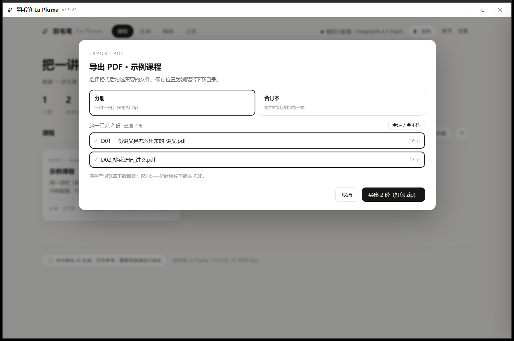
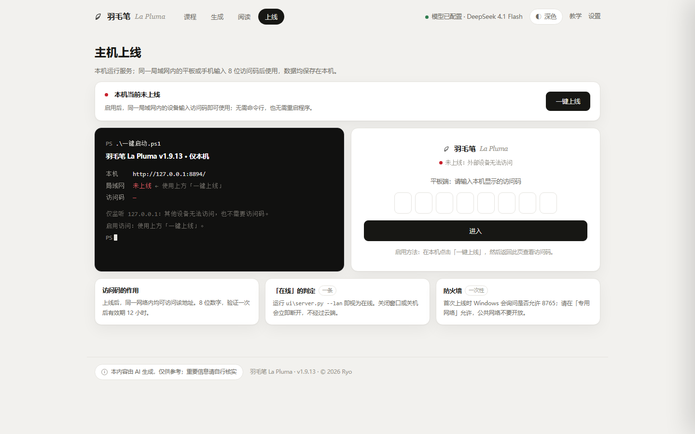

<div align="center">


<br><br>

### ⭐ 如果这个项目对你有用，欢迎点一下右上角的 ⭐
**这是对我开发最大的鼓励。**

</div>

<div align="center">

<a href="https://github.com/Charlotte0124/LaPluma/releases/latest"></a>
&nbsp;
<a href="一键启动.ps1"></a>
&nbsp;
<a href="docs/00-总索引.md"></a>

<sub>↑ 上面三个是按钮，可以直接点：下载、一键启动、文档</sub>

</div>

<div align="center">


</div>

## 目的

把**备课**与**排版**这两件事彻底分开。

一次备课的成果应当可以长期复用：换一个学期、换一台电脑、换一家打印店，产出的讲义仍是同一份。而多数「AI 直接生成文档」的链路做不到这一点——同样的输入运行两次，页数、编号、术语都可能不同，于是成品既难以核对，也无法交给别人复核。

本项目要验证的命题是：只要数据足够规整、检查足够严格，讲义这类高度结构化的文档就可以像程序一样被构建、被验收、被回归测试。

## 它是什么

羽毛笔（La Pluma）是一个**本地优先的讲义渲染器**。

输入是你已经备好的课程数据——每一讲的结构、讲法、原文引用与符号表，写成一份可读的 Python 数据文件；输出是一份可打印、可核对的讲义 PDF。渲染过程是确定性的：**同一份数据重跑，页数不该变**，章节目录、术语表首现位置、图注与原文页码也都不该变。这是它与「让模型直接写一篇」的根本区别。

两者是不同类型的工具：语言模型擅长发散与起草；讲义需要的是可复现、可审阅、可追责——学生拿到的每一页都能对回原始课件的页码，出了问题能定位到具体一节，而不是归因于「模型今天的输出不一样」。

为此，项目把三件事拆开：

| 拆开的 | 在哪 | 为什么 |
|:--|:--|:--|
| 数据 | B 层：每讲一份 `LESSON` | 内容改动不该引起版式变动 |
| 版式 | A 层：`engine/` | 版式改动不该引起内容变动 |
| 检查 | C 层：`tools/print/`、`tools/src/` | 检查与生产解耦，红了就不出货 |

**三种使用方式**：

1. **已有数据 → 出 PDF**：不需要任何 API 密钥，全程离线。
2. **改内容 → 重跑一条命令**：改那一讲的 `LESSON` 数据，`python engine\_make.py <讲号>`。
3. **让模型起草新内容（可选）**：配置 DeepSeek 密钥后走 D 层；不配置也不影响前两种。

| 我想… | 去哪 |
|:--|:--|
| 装上直接用 | [下载](#下载) · [一键启动](#一键启动) |
| 先看它长什么样 | [界面](#界面)（真截图） |
| 看「原始课件 → 成品」差多少 | [示例：桃花源记](docs/示例/README.md)（4 页 → 13 页） |
| 给平板 / 手机用 | [一键启动](#一键启动) 里的「一键上线」（8 位访问码） |
| 知道生成怎么跑 | [一条命令](#一条命令) · [三道门](#三道门) |
| 懂它分几层、怎么改 | [分五层](#分五层每层可单独换) |
| 看全部文档 | [`docs\00-总索引`](docs/00-总索引.md) |
| 配模型、看余额 | [模型与用量](#模型与用量) |

## 下载

**它解决的问题**：不是让模型写一篇作文，而是把**已经备好的课**变成一份可打印、页数可核对、每次重跑都一致的讲义 PDF。数据、版式、检查三者分离，任何一处改动都可以单独验证。

**它不解决的问题**：内容是否正确、类比是否恰当、例题数字是否算对，脚本无法判定——这一步必须由人复核。每份成品的页脚固定印有「本内容由 AI 生成，请自行核实重要信息」。

**从源码运行（当前唯一方式）**

```powershell
git clone https://github.com/Charlotte0124/LaPluma.git
cd LaPluma
.\一键启动.ps1
```

- 需要 Python 3.12（脚本会检查并提示），依赖仅 `pymupdf`
- 需要本机 Chrome 或 Edge（用于打印 PDF，无需另行安装）
- **仓库自带示例课程 `DEMO`**：无需准备任何教材，即可完整走一遍「数据 → 讲义 → PDF → 三道门」：

```powershell
$env:PLUMA_COURSE='DEMO'
python engine\_make.py D01
```

接入自己的课件：把数据写成 `<课程代码>\_lessons\<讲号>.py`（结构见 `DEMO\_lessons\D01.py`），并在 `courses.json` 中登记一行。

> 示例课程包含两讲：`D01` 说明流水线自身的运行方式，`D02` 是《桃花源记》（13 页）。
> 配合 [docs\示例](docs/示例/README.md) 中那 4 页**原始课件**对照阅读，可以看出「加工」究竟增加了什么。

## 一键启动

`一键启动.ps1` 完成四件事：检查 Python → 缺少 `pymupdf` 则安装 → 启动本地界面 → 打开浏览器。**默认仅监听 127.0.0.1，不对外网开放。**

```powershell
.\一键启动.ps1
# 或仅需命令行：
python engine\_make.py L01
```

**平板 / 手机使用**：打开界面右上「上线」页 → 点击 **一键上线**，当场给出局域网地址与 8 位访问码；点击「关闭上线」或在运行主机上关闭窗口即断开。命令行等价写法为 `一键启动.ps1 -Lan` 或 `python ui\server.py --lan`，两者执行同一段代码。

**首次启动会进入配置向导**：选择模型版本（4.1 Flash / 4.1 Pro，两档）→ 填写 API 密钥（可跳过）→ 选择保存目录 → 完成。之后可随时在右上「设置」中修改；如需重看引导，进入设置点击「重看教学」。

## 界面

界面分为**四个分页（课程 / 生成 / 阅读 / 上线）**，外加课件会话与搜索面板，支持日间 / 夜间两套主题。以下截图均来自示例课程 DEMO，1440×900。

<div align="center">

</div>

<p align="center"><sub><b>课件会话</b>：一门课一个会话；回答仅依据该课程的内容数据，每条附 §节号与课件页码，命中片段可展开核对。</sub></p>

<div align="center">

</div>

<p align="center"><sub><b>搜索</b>：放大镜（或 Ctrl+K）展开；课程行可「打开抽屉 / 导出」，课件行可「在软件里读 / 导出」。未输入时仅列出最近搜索的三条。</sub></p>

<div align="center">

</div>

<p align="center"><sub><b>导出</b>：选择「分册 / 合订本」，勾选需要的讲义（默认全选）；单份直接下载，多份打包，合订本拼成一册。</sub></p>

<div align="center">

</div>

<p align="center"><sub><b>导出笔记</b>：勾选问答 → 选择讲义（可多选）→ 每份各生成副本并追加附页，原件不动。</sub></p>

<div align="center">

</div>

<p align="center"><sub><b>主机上线</b>：一键上线后给出局域网地址与 8 位访问码，同一局域网内输入访问码即可使用。（图中地址与访问码为文档示例值）</sub></p>

- **课程**（分页一）：按目录自动识别；卡片右上 ☆ 加入收藏，顶部可切换「全部 / 收藏」；标题右侧**放大镜**（Ctrl+K）可检索课程与课件；卡片右下「⇩ 导出 PDF」导出该门成品
- **成品**：点击课程 → 右侧抽屉列出该门讲义 → 点击文件名在软件内阅读（不打开新标签页）
- **阅读**（分页三）：应用内阅读 PDF，支持翻页、缩放，右侧栏可边读边记；深色主题下正文反相，位图（课件原图）保持原色
- **笔记**：记录在当前页；「添加到这份 PDF」生成副本，将笔记作为附页追加至末尾（不改动原件）
- **会话**：抽屉底部「问这一门 →」进入该课程专属会话，答案附节号与课件页码；讲次可多选，跨课件引用需显式开启
- **导出笔记**：勾选消息 → 生成笔记 → 选择讲义（可多选）追加至末尾（默认本地整理，不消耗 token）
- **生成**（分页二）：选择课程与讲次（可多选）→ 确认免责声明 → 开始；任务进入队列，成功后自动移除，失败标红
- **上线**（分页四）：一键上线 → 局域网地址 + 8 位访问码；数据全部留在本机
- **设置**：模型版本（4.1 两档）、API 密钥、保存目录、账户余额、累计 token 与估算花费
- **界面改动流程**：尚未实现的稿件在 [`docs/预览`](docs/预览/README.md)；修改 `ui\` 后需运行 `python tools\check\check-ui-preview.py`

## 一条命令

```powershell
python engine\_make.py L01
```

```
生成 L01_零基础_讲义_源.html（23738 字符，术语附英 51 处，拆长段 0 处）
OK  CS340/06_笔记/L01_零基础_讲义_源.html
1 份讲义源：OK 1 · WARN 0 · FAIL 0
已写    …\CS340\01_讲义\L01_操作系统是什么_讲义.pdf（1433 KB · 15 页 · 10287 字符）
OK  L01_操作系统是什么_讲义.pdf
```

它不解决的问题：**内容是否正确，脚本无法判定。** 类比是否恰当、例题数字是否经过验算，需要人工复核。每份成品页脚均印有「本内容由 AI 生成，请自行核实重要信息」。

## 分五层，每层可单独替换

| 层 | 目录 | 职责 | 替换后的影响 |
|:--|:--|:--|:--|
| **A 引擎** | `engine/` | 数据 → 讲义源 HTML（模板、封面、目录、术语表、附录） | 版式变化，内容不变 |
| **B 内容** | `CS340/_lessons/` | 每讲一份 `LESSON`：节、讲法、原文引用、符号表 | 内容变化，引擎不变 |
| **C 门与打印** | `tools/print/` | 内容门 / 版式门、术语附英、HTML→PDF | 成品无法产出 |
| **D 模型** | `api/client.py` | 内容生产所用的模型调用，密钥永不入库 | 已有数据仍可生成 PDF |
| **E 界面** | `ui/` | 本地网页：课程、成品、生成、向导、设置 | 仅剩命令行 |

A/B/C 三层可离线运行；仅「让模型撰写新内容」时才需要 D 层。

## 三道门

| 门 | 判定内容 | 不通过时 |
|:--|:--|:--|
| 源 | 课件引用对得上、图注非空 | 停止，不产出成品 |
| 内容 | `data-reader` · 公式后符号表 · 每节讲法 · 术语首次附英 · 单段 ≤210 字 | 修改内容，不放宽阈值 |
| 版式 | 页首为标题/表格/图注、无空白残页 | 整节迁移或调整块边界分页 |

**检查器不得为了通过而放宽。** 这是整套工具可信度的全部来源。

## 模型与用量

- 模型：仅保留两档 —— DeepSeek 4.1 Flash（默认，快且省）/ 4.1 Pro（质量更高）；接口 id 为 `deepseek-flash` / `deepseek-v4-pro`，设置中可随时切换
- 密钥读取顺序：`PLUMA_API_KEY` 环境变量 → `%USERPROFILE%\.pluma\api.json` → PRTS 侧 secrets → 界面填写
- **余额**取自接口真实数值（`/user/balance`）；**花费**按 token 单价估算，界面明确标注「估」，不作为账单

## 最近更新

> 本表由 `tools\sync-readme.py` 从 [CHANGELOG](CHANGELOG.md) 生成，请勿手改；`--check` 可校验一致性。

<!-- 最近更新:begin（由 tools/sync-readme.py 生成，别手改） -->
| 版本 | 日期 | 这一版做了什么 |
|:--|:--|:--|
| **v1.8.0** | 11-17 | **课程旁的放大镜（设计稿 15）**：「课程」标题右侧一个圆按钮，展开是搜索栏，`Ctrl+K` 唤出；结果分「课程」「课件」两组。按浏览器逻辑：**没输字时只摆最近搜过的三条**（本机 localStorage，最多存 8 条），Esc 一次清空输入、再一次收起，点结果或回车才算一次「搜索」才进历史；**搜索结果行可直接导出**：课程行是「打开抽屉 / 导出」（整门打包一个 zip），课件行是「在软件里读 / 导出」（单份原 PDF）；课程卡右下角同时有「⇩ 导出 PDF」（设计稿 16），与课程行走同一段后端… |
| **v1.7.0** | 11-17 | **「生成」页布局修好**：根因是 `.pad` 类名撞车——v1.5.0 给上线页的平板预览写了 `.pad{display:flex;align-items:center;text-align:center;min-height:280px}`，而生成页两张卡叫 `class="card pad"`，于是整卡居中、键值不再右贴。平板预览面板改名 `.device`（不是换字体：实测全库字体栈自始至终一致）；**两处字体小偏差**：`<code>` 会被浏览器默认样式抢成 Courier（`.fld code` 已改回继承 Consolas）；`.opt b` 落成 700 字重（已定 600）… |
| **v1.6.0** | 11-17 | **打包地基**：新增 `paths.py`，把「只读资源」与「可写数据」分成两根；`/api/generate` 与引擎内部全部改成进程内调用，不再用 `sys.executable` 起第二个 exe；新增判据 `tools\check\check-paths.py`：假打包现场判 7 项，自带造坏自测（造坏 3 红、复原 7 绿）… |
| **v1.5.0** | 11-16 | 界面改成**四个分页**：课程 / 生成 / 阅读 / 上线；顶栏一个「◐」切白天黑夜，主题存本机；**05/06 会话页重做**：每条消息可勾选、讲次改成勾选多选（空 = 整门课，可只选几讲）、模型回答按 Markdown 渲染（粗体 / 行内代码 / 代码块，不再把 `**` 直接晒出来）… |
| **v1.4.0** | 11-16 | 界面新增「成品形态」：**单本（默认）/ 合订本**；合订本按 B 口径（一张封面 + 一张总目录，去掉各讲自带的封面与目录），选中时讲次选择自动置灰；新增 `engine/_book.py`：九讲合订本；自检三条——节数与各讲对得上、页数 = 1 + 目录页 + Σ(各讲页数 − 2)、目录 9 条全回填（实测 144 页 = 1 + 1 + 142）… |
| **v1.3.1** | 11-16 | 引擎：`fig` 引用的课件原图改成可配置目录（`~/.pluma/assets.json` → `courses.json` → `PLUMA_ASSETS` → 仓内默认），找到就写绝对 `file://` URI；**找不到就报缺图并停**，不再产出「图是白条、门还报绿」的成品；新增 `tools/assets.py`：`--list` / `--check` / `--set` / `--unset`（本机配置，不入库）… |
| **v1.3.0** | 11-16 | L06 / L08 / L09 重做为练习型：三讲共 54 页 / 25 段代码 / 33 道例题 / 12 张结构图（地址空间对照、create→join 时序、丢更新、条件变量往返；地址轴、调用栈、空闲链表、malloc 间隙；base/limit、段表、页表翻译、两级页表）；L05 排版返工：拆成 15 节、一节一页；块级不可拆（代码/例题/图/表），断点只落在节标题上… |
| **v1.2.1** | 11-16 | L05 重做为练习型：17 页 / 7 段代码 / 11 道例题 / 4 张结构图（三类 IPC、竞争条件时间线、down·up 路径、环形缓冲）；修两个渲染 bug：长段拆分把 </p> 插进了代码块（正则把 <pre> 误当 <p>）；表格里的 ** 粗体没生效… |
| **v1.2.0** | 11-16 | 讲义改口径：以代码、例题运算为主，理论只作铺垫；需要时配结构示意图；引擎新增三种块：代码（code）、例题（eg）、结构图（svg）；术语附英不再误入图与代码… |
| **v1.1.0** | 11-16 | 新增首次配置向导（选模型 → 填 API 钥匙 → 选保存目录 → 完成），未配置时自动弹出；新增设置面板：模型版本、密钥、保存目录、账户余额、累计 token 与估算花费… |
| **v1.0.0** | 11-16 | 补齐 L01「操作系统是什么」，九讲齐（9 份 / 166 页），三门全绿；版本定到 v1.0.0；主页横幅、界面截图重出 |
| **v0.3.0** | 11-16 | 新增 E 层本地界面（`ui/`）：课程卡片 → 成品列表 → 点击直接打开；生成前免责声明；新增用户文档（总索引 → 分类 → 篇）与主页横幅 |
| **v0.2.0** | 11-16 | 新增 D 层 API 接入（DeepSeek 兼容口径），密钥三级回退，永不入库 |
| **v0.1.0** | 11-16 | 骨架落地：A 引擎 / B 内容（L02–L09）/ C 三道门与打印；L02 全链跑通 |
<!-- 最近更新:end -->

## 目录

```
paths.py           路径双根（只读资源 / 可写数据，冻结后各指一处）
engine/            A 引擎（_build_讲义.py / _make.py / _split_long.py / _pagediag.py）
CS340/_lessons/    B 内容数据（L01–L09 九讲，不入公开仓）
DEMO/_lessons/     示例课程数据（D01 流水线自述、D02 桃花源记）
CS340/06_笔记/     生成的讲义源（不入库）
CS340/01_讲义/     生成的 PDF（不入库）
tools/print/       C 内容门 / 版式门 / 打印 / KaTeX / pdf.js
tools/src/         源门
tools/check/       自检（check-ui-preview.py 界面先出图；check-paths.py 路径双根）
tools/sync-readme.py  主页「最近更新」生成器
api/               D 模型接入
ui/                E 本地界面
docs/              项目文档（总索引 → 分类 → 篇）
docs/示例/         桃花源记：原始课件（范本）与加工后讲义
courses.json       课程元数据（标题 / 说明 / 读者口径）
```

## 依赖

Python 3.12、`pymupdf`、本机 Chrome 或 Edge。无前端构建、无 npm、无服务端数据库、无第三方 Web 框架。

## 致谢

- 排版思路与工程纪律沿用在 **Rosmarinus（迷迭香）** 项目中沉淀的做法：可用机器判定的规则、红项不出货、检查器不得为通过而放宽
- 界面与文档的两级索引形式参考 **PRTS** 工作台的「总索引 → 分类 → 篇」结构
- 仓库保护机制（使用声明与二次分发约束）参考 **Alpha2** 项目的做法，特此致谢
- 公式渲染使用 [KaTeX](https://katex.org/)（本地字体，不联网）

## 许可与免责

MIT，见 [LICENSE](LICENSE)。

使用与二次分发请遵守上述声明；商业使用前建议先阅读本页「它是什么」与「它不解决的问题」两节。

**本内容由 AI 生成，请自行核实重要信息。** 页脚标识不可关闭。
