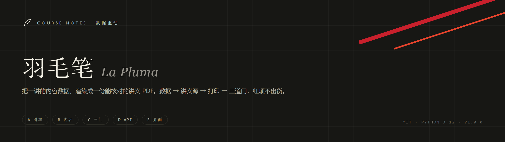

# 羽毛笔 La Pluma · 总索引

一句话：**把一讲的内容数据，渲染成一份能核对的讲义 PDF。**

| 想知道什么 | 去哪看 |
|:--|:--|
| 装上就能跑起来 | [使用/01-快速开始](使用/01-快速开始.md) |
| 怎么把一讲出成 PDF | [使用/02-生成一讲讲义](使用/02-生成一讲讲义.md) |
| 三道门到底判什么、红了怎么办 | [使用/03-三道门](使用/03-三道门.md) |
| 模型 key 放哪、会不会进仓库 | [使用/04-API与密钥](使用/04-API与密钥.md) |
| 这一整套分几层、怎么改 | [使用/00-分类介绍](使用/00-分类介绍.md) |

## 现在能做什么

| 项 | 现状（实测） |
|:--|:--|
| 讲义生成 | `python engine\_make.py L02`，一讲一条命令 |
| 内容数据 | CS340 共 9 讲可生成（L01–L09），9 份成品 166 页，全部过门 |
| 质量门 | 源 / 内容 / 版式三道，任一红即停 |
| 界面 | `python ui\server.py`，浏览器里选课、看成品、生成 |
| 模型接入 | DeepSeek 兼容口径，`deepseek-flash` / `deepseek-v4-pro` |

## 两条边界，先说清

1. **AI 生成的内容可能不准。** 每份成品页脚都印着「本内容由 AI 生成，请自行核实重要信息」，不可关闭。
2. **脚本判不了对错。** 三道门只检查格式与结构（术语、符号表、讲法、页首字体…），类比是否误导、例题数字是否真算过，仍需人工抽查。
