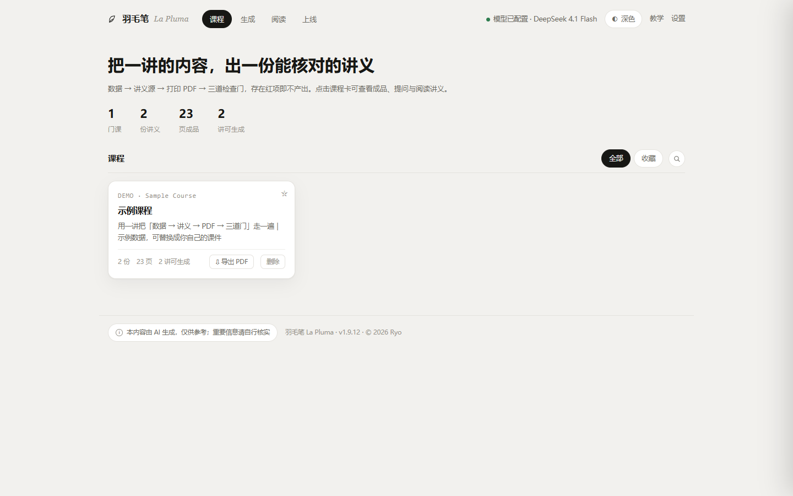

# 分类介绍 · 这套东西分五层



一句话读数：**A 引擎决定怎么排，B 内容决定写什么，C 门决定能不能出门，D 是模型，E 是界面。**

## 为什么要分层

以前讲义是「一个脚本干到底」：改版式就碰内容，加一讲就碰排版，出了问题说不清是哪一层。分成五层后，每一层都能单独换掉，判断也简单：**改的是「怎么写」，还是「写什么」。**

## 五层各管什么

| 层 | 目录 | 干什么 | 换掉它 | 能离线吗 |
|:--|:--|:--|:--|:--|
| A 引擎 | `engine/` | 数据 → 整份讲义源 HTML（模板、封面、目录、术语表、附录） | 版式变，内容不变 | 能 |
| B 内容 | `CS340/_lessons/` | 每讲一份 `LESSON` 数据：节、讲法、原文引用、符号表 | 内容变，引擎不变 | 能 |
| C 门与打印 | `tools/print/` | 内容门 / 版式门、术语附英、HTML→PDF | 成品出不去 | 能（要本机 Chrome） |
| D 模型 | `api/client.py` | 内容生产时的模型调用 | 已有数据仍能出 PDF | 不能 |
| E 界面 | `ui/` | 本地窗口：选课、看成品、生成、免责声明 | 只剩命令行 | 能 |

## 数据怎么在层间流动

```
CS340/_lessons/L02.py        ← B 层：你写的
        │  engine/_build_讲义.py（A 层）
        ▼
CS340/06_笔记/L02_…_源.html   ← 中间产物
        │  tools/print/terms.py（每节首次附英）＋ _split_long.py（长段拆分）
        │  tools/print/audit_lesson.py --content（内容门）
        ▼
tools/print/html2pdf.py       ← 本机 Chrome 无头打印，自动回填目录页码
        ▼
CS340/01_讲义/L02_…_讲义.pdf  ← 成品
        │  tools/print/audit_lesson.py CS340（版式门）
        ▼
   绿 → 交付；红 → 停在原地，日志写原因
```

## 一条决定不能回头

**不许为了变绿去改检查器。** 门红了说明内容或版式真有毛病，改内容；把阈值调低的改动一律回退。这条是整套东西可信度的来源。
