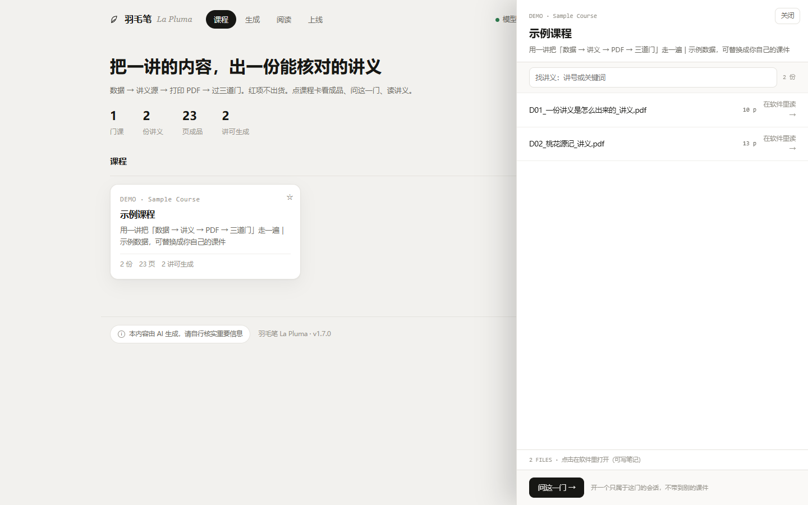

# 生成一讲讲义



一句话：**一讲一份数据文件，改内容只碰那个文件；排版与固定件由引擎产出，不手改 HTML。**

## 数据文件长什么样

> **2026-11-16 起口径（练习型）**：讲义以**代码、例题运算为主，理论只作铺垫**；需要时配一张结构图。内容门已加判据：每个概念节至少要有一个代码块（`code`）或例题块（`eg`）。

四种块（body 里直接写）：

| 块 | 写法 | 排版出来是什么 |
|:--|:--|:--|
| 代码 | `("code", "c", 代码文本, "说明")` | 深色代码面板 + 左侧琥珀边，说明在右侧 |
| 例题 | `("eg", "题面", ["第1步", "第2步"], "答案：…")` | 三行：题面 / 编号步骤 / 答案（琥珀色） |
| 结构图 | `("svg", svg源码, "图注")` | 整块居中、禁止跨页拆分 |
| 引文 | `("q", 英文原句, "课件 p.N")` | 灰底引文 + 右下出处 |


`CS340/_lessons/L02.py` 里就是一个 `LESSON` 字典：

```python
LESSON = {
    "code": "CS340", "no": "L02",
    "zh": "进程的基本管理", "en": "Basic Process Management",
    "out": "L02_进程的基本管理_讲义.pdf",
    "meta": [("源课件", "L02_BasicProcessManagement.pdf，58 页"), ("页码口径", "「课件 p.N」指源 PDF 页序")],
    "sections": [
        {"no": "0", "zh": "本讲导读", "en": "How to Use This Handout",
         "lec": "这一节怎么讲：先给边界，再说前置知识。",
         "body": [
             ("p", "<b>这一节能解决什么。</b>正文段落……"),
             ("q", "原文引用，必须和源课件逐字对得上", "课件 p.4"),
         ]},
    ],
    "appendix": {"symbols": [["符号", "读法·含义", "出处"]], "myths": ["常见误解"]},
}
```

三条写作约定：

1. **`lec` 必须有**（每节讲法），内容门会判；
2. **公式后要有符号表**（`appendix.symbols`），判据是「这一节出现了公式却没符号表」为红；
3. **单段不超过 210 字**，超了 `_split_long.py` 会自动拆，但你最好自己在写的时候就拆。

## 一条命令走完四步

```powershell
python engine\_make.py L02
```

它依次做：生成源 HTML → 术语每节首次附英 → 内容门 → 打印 PDF → 版式门。任何一步红就 `return 1`，后面不再跑。

想一次多份：`python engine\_make.py L03 L04-01 L05`。

## 在界面里生成

1. 起界面：双击 `一键启动.bat`（或 `python ui\server.py`，v1.9.0 起默认开自己的窗口）
2. 「生成」里选讲次（芯片多选，列的是 `_lessons` 里真实存在的）
3. 选输出方式
4. 点「开始生成」→ 弹免责声明 → 勾选 → 继续
5. 日志面板会原样打出命令输出，`成功` / `失败` 在首行

## 加一讲要做的事

1. 在 `CS340/_lessons/` 新建 `L07.py`，照上面结构写（变量名必须叫 `LESSON`）；
2. `python engine\_make.py L07`；
3. 门全绿后成品进 `CS340/01_讲义/`，界面刷新就能看到。

不需要改引擎、不需要改界面——这是分层的目的。

## 常见坑

| 坑 | 后果 | 改法 |
|:--|:--|:--|
| 手改生成的 HTML | 下次构建被覆盖 | 改数据文件，别改产物 |
| `"out"` 文件名和讲号不一致 | 版式门对不上，报找不到 | 文件名带上讲号 |
| 引用不带页码 | 源门判「引文无出处」 | `("q", 原文, "课件 p.N")` |
| 术语只在图注里出现 | 术语表被判缺失 | 正文或术语表里补一次 |
